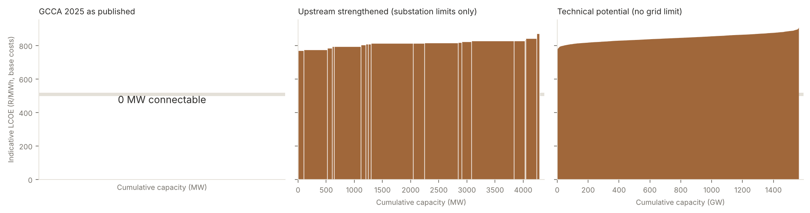

# GeoReady · solar investment readiness, Northern Cape

GeoReady is a reproducible screening model for utility-scale solar PV. It goes one step past site
suitability and asks what stands between good sun and a connectable project: eligible land,
capacity, indicative cost, **grid headroom** and permitting. It is the first model of the
Open Energy GeoHub suite, piloted for the Northern Cape, South Africa.

The model runs as five Jupyter notebooks on a small Python package. The same notebooks run in
the **QGIS Notebook** plugin, where the last cell loads the results onto your map.



## What the pilot finds (run `2026-11-26_nc-pv-v01_3d5fc633`)

* **Land is not the constraint.** About 184,000 km², half the province, passes every exclusion.
  Cut into 2,132 candidate zones and built out at 10% of eligible land, that is about 1,560 GW
  of technical potential.
* **The grid is.** Under NTCSA's GCCA 2025 as published, every zone sits behind a supply-area or
  local-area limit of **0 MW**: nothing is connectable.
* **Even if the backbone were reinforced,** substation limits alone allow about **4.3 GW**, taken
  by 18 zones. Eight substations, including Upington, Kronos, Paulputs and Garona along the
  solar corridor, report 0 MW even at the substation, though about 45% of the technical
  potential sits behind them.
* **Cost barely separates zones.** 90% of zones fall within ±5% of the median base-case LCOE.
  What separates them is grid headroom.
* **Calibration.** The low cost case (median ≈ R540/MWh) lands near REIPPPP Bid Window 7 solar
  prices (R500–514/MWh). The base case (≈ R850/MWh) is conservative: fixed-tilt yield, a public
  discount rate, cautious CAPEX. Read the cost axis as relative.

## What it must not be used for

A readiness score is not an environmental authorisation, a land entitlement, an engineering
design or a bankable feasibility study. Grid headroom comes from a dated public assessment and
is not a connection offer. GCCA limits are shared with projects outside the province, which are
not modelled, so every allocation is an upper bound. Unknown values are kept apart from zero.

## Method

| Notebook | Does |
|---|---|
| `00_run_record` | Creates the run: `run_id`, parameter file, input checksums, software versions |
| `01_eligibility_zones` | Codes every 250 m cell with an exclusion reason: protected area (legal, burned all-touched), then technical thresholds (land cover, slope > 15°, PVOUT < 1,900, > 50 km from a ≥132 kV substation). Cuts eligible land into 10 km zones that never cross a GCCA substation zone |
| `02_capacity_cost` | MW = eligible km² × 87 MWdc/km² × land-use factor; yield from PVOUT; connection cost per project; LCOE for low, base and high cases |
| `03_grid_readiness` | Joins GCCA 2025 limits (substation ⊂ local area ⊂ supply area), allocates capacity cheapest-first so shared headroom is never double-counted, draws supply curves, scores readiness 0–1 and tests weight sensitivity |
| `04_qa_publish` | Release gate, then writes the GeoPackage, CSVs, eligibility GeoTIFF, an OSeMOSYS-style regional band table and the run record |

**Allocation.** Each zone sits behind one chain of nested limits, so the limits form a laminar
family and cheapest-first filling is optimal. `tests/test_allocate.py` checks it against a linear
programme (SciPy HiGHS) on 40 random networks.

**Readiness.** Weighted sum of resource (0.20), cost (0.25), distance to grid (0.15), grid
headroom (0.25) and REDZ overlap (0.15), each normalised with fixed bounds from the config so a
score means the same in every scenario. A zone missing any criterion gets no score, not a low one.

**QA gate** (all must pass before outputs are written): no eligible cell touches a protected area
and zone polygons overlap protected areas by 0 km²; allocations stay within every known limit in
every scenario; zones behind unknown headroom are flagged and get 0 MW; capacity equals area ×
density; weights sum to 1; 59 unit tests pass.

All assumptions, with sources, are in [`config/northern_cape_pv.yaml`](config/northern_cape_pv.yaml).

## Run it

```bash
git clone https://github.com/seabilwe/geoready && cd geoready
pip install -e ".[notebooks,test]"
# put the prepared inputs in data/prepared/ (see data/README.md)
jupyter lab notebooks/
```

Run the notebooks in order. Each writes into `runs/<run_id>/`.

### In QGIS

1. Install **Notebook** (Qiusheng Wu) from *Plugins → Manage and Install Plugins*.
2. QGIS's Python needs `pytest` and `scipy` for the tests. In the OSGeo4W Shell:
   `python -m pip install --user pytest scipy`. GeoPandas, rasterio and the rest ship with QGIS.
3. Open `notebooks/00_run_record.ipynb` in the Notebook panel and run the cells, then 01 to 04.
   The plugin shows printed text, so tables print and figures are saved into the run folder.
4. The last cell of `04_qa_publish` adds the styled zones and eligibility grid to your map.

## Data

Global Solar Atlas 2.0 (World Bank Group, Solargis; CC BY 4.0) · Copernicus DEM GLO-90 ·
DFFE SANLC 2022 · WDPA (UNEP-WCMC & IUCN) · DFFE/CSIR REDZ and renewable energy EIA
applications · NTCSA Generation Connection Capacity Assessment 2025 · geoBoundaries ·
© OpenStreetMap contributors (ODbL). Raw data are not redistributed: see [data/README.md](data/README.md).

Cost sources: IRENA (2025) *Renewable Power Generation Costs in 2024*; Eskom 240-104073096
*Sub-transmission building blocks for IPP integration*; Stats SA CPI; NREL ATB; IRP 2019
discount rate; REIPPPP BW7 results (DEE/IPP Office). Land use: Bolinger & Bolinger (2022),
*IEEE Journal of Photovoltaics*, doi:10.1109/JPHOTOV.2021.3136805.

## Licence

Code MIT. Data keep their own licences.

*Seabilwe Tilodi, 2026. Part of the Open Energy GeoHub (in development).*
